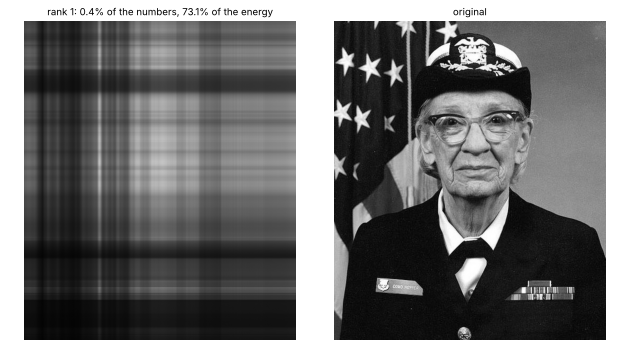
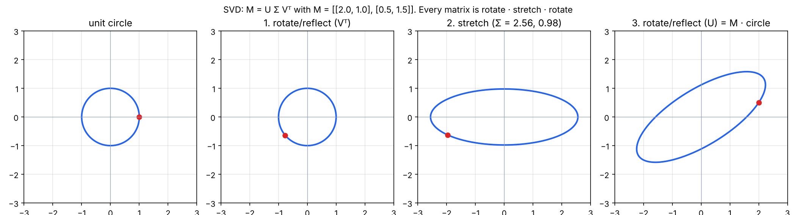
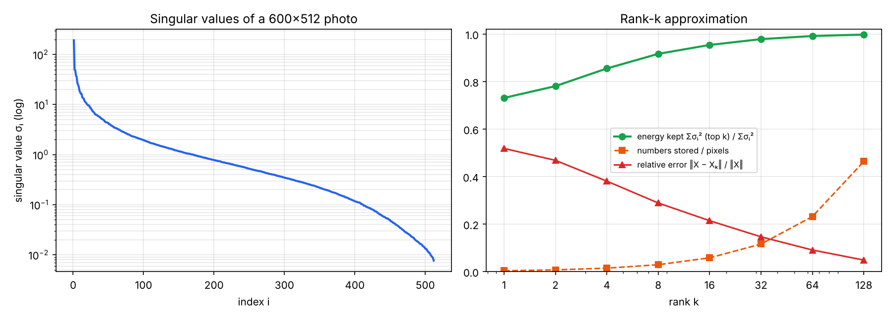
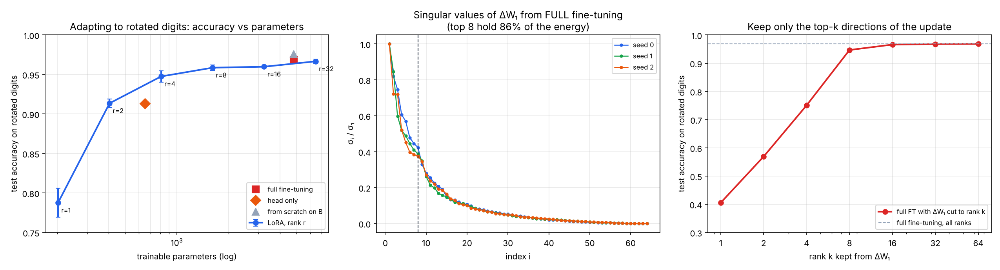

# 09 · Low-rank, SVD & why LoRA rank 8 is enough

🇸🇰 [Slovenská verzia](README.sk.md) · 📘 [Step-by-step tutorial](TUTORIAL.md)

## TL;DR
The math minimum before P5 (fine-tuning with LoRA). Goal from the roadmap: *explain why LoRA with rank 8 is enough*. Three NumPy experiments (fixed seeds, every number from `results.json`):
- **SVD = rotate · stretch · rotate.** Any matrix maps the unit circle to an ellipse; the singular values are the ellipse's half-axes. For the 2×2 example they are 2.56 and 0.98, and their product equals |det| = 2.50.
- **Most of a photo lives in a few directions.** In a 600×512 photo, the top 8 of 512 singular values hold **91.7 % of the energy**, and storing them takes 2.9 % of the numbers. Truncated SVD is the *best* rank-k approximation (Eckart–Young): the measured error matches √(dropped σ²) to 1e-14.
- **The update fine-tuning finds is low-rank.** I pretrained a small MLP on handwritten digits, then fine-tuned it on the same digits rotated by 90°.
  - The full fine-tuning update ΔW₁ (64×64) keeps **86 % of its energy in its top 8 directions**.
  - Cut down to rank 8, it still gives **94.7 %** accuracy; at rank 16, **96.6 %** (the full update gives 96.9 %).
- **LoRA (frozen base + trainable A·B):** rank 8 reaches **95.9 %** with 1616 trainable parameters, vs 96.9 % for full fine-tuning with 4810. Rank 1 gets 78.8 %, rank 2 91.4 %; above rank 8 the curve is flat.
- **In a real LLM** one 4096×4096 projection has 16.8 M weights, and a rank-8 LoRA trains **65 536 = 0.39 %** of them.



## Start here
Large models contain enormous tables of weights. Changing every number for a new task is expensive. **LoRA** keeps the original weights fixed and learns a small correction made from two narrower matrices. This task asks: **can such a small correction be enough?**

A picture makes the idea concrete. A greyscale photo is a matrix of numbers; many rows and columns contain related patterns. **SVD** ranks those patterns by importance. Keeping only the first 8 preserves 91.7% of the measured “energy” in this experiment while storing 2.9% as many numbers. That number describes a mathematical approximation, not a subjective image-quality score.

The project then tries the same idea on a small digit-recognition network. After changing the task, it freezes the original weights and trains only a LoRA correction. A rank-8 correction reached 95.9% accuracy versus 96.9% when updating all weights, while training 1,616 rather than 4,810 parameters. The GIF shows how the image changes as more patterns are kept. This is evidence for the small experiment; it does not prove that rank 8 always suffices for every large model.

## Problem
LoRA fine-tunes a big model by freezing every weight matrix W and learning a small update ΔW = A·B, where A is d×r and B is r×k with r ≈ 8. Why should an update with only r independent directions be enough to teach a 7B model a new task? Answering that needs three ideas:
1. what **rank** means: how many independent directions a matrix really uses;
2. **SVD**: how to find those directions, ordered by importance;
3. the observation (LoRA paper, Hu et al. 2021) that fine-tuning updates have low **intrinsic rank**.

Sources: 3Blue1Brown, Essence of Linear Algebra (eigen / change of basis); the LoRA paper.

## How it works

### 1. SVD on a 2×2 matrix (`svd_2x2`)
Every matrix M can be written as `M = U Σ Vᵀ`, where U and V are rotations (or reflections) and Σ is a diagonal stretch. Applied to the unit circle:
1. Vᵀ turns the circle, which still looks like a circle;
2. Σ stretches it along the axes by σ₁ = 2.56 and σ₂ = 0.98;
3. U turns the ellipse into its final position.

The reconstruction U Σ Vᵀ matches M to 7e-16. Area scales by σ₁·σ₂ = 2.50 = |det M|.



### 2. Rank-k approximation of a photo (`image_svd`)
A grayscale photo is a 600×512 matrix X. Write it as a sum of rank-1 layers, each one "a column pattern times a row pattern":
```
X = σ₁ u₁ v₁ᵀ + σ₂ u₂ v₂ᵀ + …        keep the first k:  Xₖ = U[:, :k] Σ[:k] Vᵀ[:k]
```
Storing Xₖ costs k·(600 + 512 + 1) numbers instead of 600·512.

| rank k | numbers stored / pixels | energy kept | relative error |
|---|---|---|---|
| 1 | 0.4 % | 73.1 % | 0.519 |
| 4 | 1.4 % | 85.5 % | 0.381 |
| 8 | 2.9 % | 91.7 % | 0.289 |
| 16 | 5.8 % | 95.4 % | 0.214 |
| 64 | 23.2 % | 99.2 % | 0.091 |
| 128 | 46.4 % | 99.8 % | 0.049 |

- The singular values fall off fast (left plot), so a few directions carry most of the image.
- **Eckart–Young:** no rank-k matrix is closer to X than Xₖ, and the error is exactly √(σ²ₖ₊₁ + …). The code checks this for every k; the gap is ≤ 1.4e-14.
- For contrast, projecting onto a *random* 16-dimensional subspace leaves a relative error of 0.978, vs 0.214 for the top 16 singular directions. Which directions you keep matters, not just how many.



### 3. LoRA on a small network (`lora_experiment`)
- **Setup:**
  - An MLP 64 → 64 (ReLU) → 10, written in NumPy with manual backprop. The cross-entropy gradient is softmax − one-hot, from step 08.
  - Pretrained for 80 epochs on scikit-learn's 8×8 digits (1257 train / 540 test): 97.8 % test accuracy.
  - **Task B** is the same digits rotated by 90°. The pretrained model gets 10.0 % on them, which is chance.
  - Every method trains for 60 epochs with Adam (lr 3e-3). The results are the mean of 3 seeds.

**LoRA** keeps W₁, W₂ frozen and learns `W_eff = W + (α/r)·A·B` for both layers:
```python
A = rng.normal(0, 1 / sqrt(d_in), (d_in, r))  # random
B = np.zeros((r, d_out))  # zero → ΔW starts at exactly 0: training starts from the pretrained model
# chain rule through W_eff:  dA = s · dW · Bᵀ,   dB = s · Aᵀ · dW
```

| Method | Trainable params | Accuracy on rotated digits (B) | Accuracy on original digits (A) afterwards |
|---|---|---|---|
| pretrained, no adaptation | 0 | 10.0 % | 97.8 % |
| head only (train last layer) | 650 | 91.3 ± 0.8 % | 26.5 % |
| LoRA r = 1 | 202 | 78.8 ± 1.8 % | 19.6 % |
| LoRA r = 2 | 404 | 91.4 ± 0.5 % | 23.5 % |
| LoRA r = 4 | 808 | 94.8 ± 0.7 % | 29.6 % |
| **LoRA r = 8** | **1616** | **95.9 ± 0.3 %** | 38.8 % |
| LoRA r = 16 | 3232 | 96.0 ± 0.2 % | 32.2 % |
| LoRA r = 32 | 6464 | 96.7 ± 0.3 % | 35.3 % |
| full fine-tuning | 4810 | 96.9 ± 0.3 % | 41.0 % |
| from scratch on B | 4810 | 97.6 ± 0.3 % | 10.0 % |



**Why rank 8 is enough: look at what full fine-tuning did.** Take ΔW₁ = W₁(after) − W₁(before) from full fine-tuning and run SVD on it (middle plot):
- the singular values drop just like the photo's;
- the top 8 of 64 hold 86 % of the energy;
- keeping only the top k directions of ΔW₁ (right plot) gives 40.6 % at k = 1, 94.7 % at k = 8, 96.6 % at k = 16, and 96.9 % with all 64.

The change a new task needs lives in a handful of directions. LoRA simply *assumes* that up front and only learns those directions.

## Results
| Check | Number |
|---|---|
| σ₁, σ₂ of [[2, 1], [0.5, 1.5]] · product vs \|det\| | 2.56, 0.98 · 2.50 = 2.50 |
| Photo 600×512: energy in top 8 singular values | 91.7 % (2.9 % of the numbers) |
| Eckart–Young gap (measured error vs √dropped σ²) | ≤ 1.4e-14 |
| Top-16 SVD vs random 16-dim projection, relative error | 0.214 vs 0.978 |
| Energy of full-FT ΔW₁ in top 8 directions (mean of 3 seeds) | 86 % |
| Full FT with ΔW₁ cut to rank 8 / 16 / 64 | 94.7 % / 96.6 % / 96.9 % |
| LoRA r = 8 vs full fine-tuning (accuracy, trainable params) | 95.9 % with 1616 vs 96.9 % with 4810 |
| One 4096×4096 matrix: LoRA r = 8 share of parameters | 0.39 % |

## Error analysis
- **Rank 1–2 is too little:** 78.8 % and 91.4 %. Undoing a 90° rotation needs several independent pixel-to-feature changes, not one.
- **Above rank 8 nothing improves much** (95.9 → 96.0 → 96.7 %), matching the truncation curve: the remaining directions of ΔW are small.
- **The head-only baseline is strong** (91.3 % with 650 parameters), because the pretrained hidden features are partly reusable. LoRA r = 4 beats it with a similar parameter count (94.8 % with 808).
- **Forgetting:** every method destroys task A, since nothing here asks it to keep A. LoRA r = 8 keeps 38.8 % vs 41.0 % for full fine-tuning, so here LoRA doesn't protect the old task any better. The often-quoted "LoRA forgets less" needs a real check in P5.
- **This network is tiny:** W₂ is 64×10, so its rank can't exceed 10. At r = 32, LoRA has *more* parameters than full fine-tuning (6464 vs 4810). LoRA only saves parameters when r ≪ the matrix dimensions, which is exactly the LLM case (0.39 %).

## Visual example: why not the cars
SVD and LoRA are about matrices, and the most direct picture of "a few directions hold most of the information" is an image rebuilt from its top singular directions (GIF at the top). The cars' small policy networks would show the same thing less clearly, so I didn't force a Racing Lab chapter.

## What I learned
- Rank = number of independent directions; SVD finds them and orders them by importance (σ₁ ≥ σ₂ ≥ …).
- Truncated SVD is the optimal low-rank approximation, and its error is exactly the dropped singular values.
- Fine-tuning updates have a fast-decaying spectrum: most of the change is in a few directions. That is the whole case for LoRA.
- LoRA's tricks: B = 0 at the start (the model begins exactly at the pretrained one), α/r scaling (changing r doesn't change the step size much), and A·B can be merged into W after training (zero extra inference cost).
- Parameter savings scale with matrix size: 34 % on a 64-wide toy, 0.39 % on a 4096-wide LLM layer.

## Run it
```bash
uv sync
uv run python svd.py     # experiments → results.json (~40 s on CPU)
uv run python plot.py    # assets/svd_2x2.png, image_svd.png, lora.png, svd_image.gif
```

## Limitations
- A 64-unit MLP on 8×8 digits is a long way from a transformer, but the mechanics (frozen W, trainable A·B, spectrum of ΔW) are the same.
- 3 seeds, 540 test images: differences under ~1 percentage point are noise.
- The photo is matplotlib's bundled sample image (Grace Hopper), converted to grayscale.
- No QLoRA here (4-bit base weights); that comes in P5 with mlx-lm.
