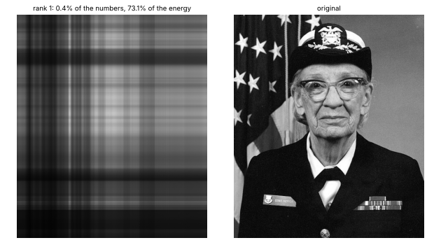
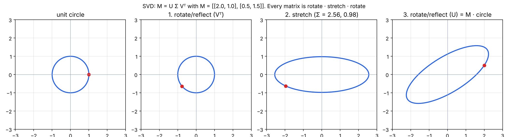
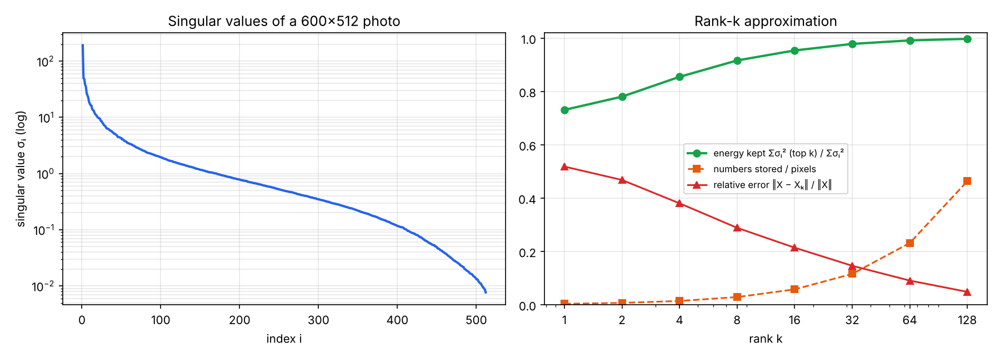
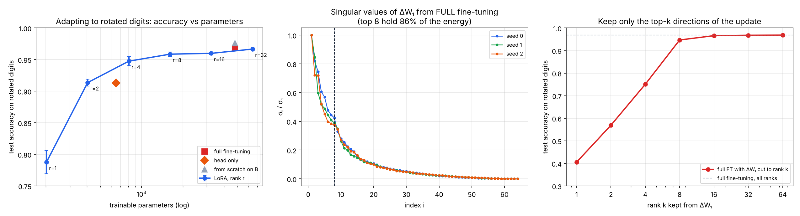

# 09 · Low-rank, SVD a prečo LoRA s rankom 8 stačí

🇬🇧 [English version](README.md) · 📘 [Tutoriál krok za krokom](TUTORIAL.sk.md)

## TL;DR
Matematické minimum pred P5 (fine-tuning cez LoRA). Cieľ podľa roadmapy: *vysvetliť, prečo LoRA s rankom 8 stačí*. Tri experimenty v NumPy (pevné seedy, každé číslo z `results.json`):
- **SVD = otočenie · natiahnutie · otočenie.** Každá matica zobrazí jednotkovú kružnicu na elipsu; singulárne hodnoty sú poloosi elipsy. Pre príklad 2×2 sú to 2,56 a 0,98 a ich súčin sa rovná |det| = 2,50.
- **Väčšina fotky žije v pár smeroch.** Vo fotke 600×512 drží 8 najväčších z 512 singulárnych hodnôt **91,7 % energie** a ich uloženie stojí 2,9 % čísel. Orezané SVD je *najlepšia* aproximácia rankom k (Eckart–Young): nameraná chyba sa zhoduje s √(zahodených σ²) na 1e-14.
- **Zmena, ktorú fine-tuning nájde, má nízky rank.** Malú MLP som predtrénoval na ručne písaných číslach a potom ju fine-tunoval na tých istých číslach otočených o 90°.
  - Zmena váh z plného fine-tuningu ΔW₁ (64×64) má **86 % energie v 8 najsilnejších smeroch**.
  - Orezaná na rank 8 dá stále **94,7 %** presnosť, na rank 16 **96,6 %** (celá zmena dá 96,9 %).
- **LoRA (zmrazená báza + trénovateľné A·B):** rank 8 dosiahne **95,9 %** s 1616 trénovateľnými parametrami, oproti 96,9 % pri plnom fine-tuningu s 4810. Rank 1 dá 78,8 %, rank 2 91,4 %; nad rankom 8 je krivka plochá.
- **V skutočnom LLM** má jedna projekcia 4096×4096 16,8 M váh a LoRA s rankom 8 trénuje **65 536 = 0,39 %** z nich.



## Najprv jednoducho
Veľký model má obrovské tabuľky váh. Pri doladení na novú úlohu by bolo drahé meniť každé číslo. **LoRA** nechá pôvodné váhy na pokoji a učí iba malú opravu, ktorú vie poskladať z dvoch užších matíc. Otázka tejto úlohy je: **môže taká malá oprava stačiť?**

Pomôže príklad s obrázkom. Čiernobiela fotka je matica čísel; veľa jej riadkov a stĺpcov nesie podobné vzory. **SVD** tieto vzory zoradí podľa dôležitosti. Keď ponecháme len prvých 8, fotka v tomto pokuse zachová 91,7 % meranej „energie“ pri uložení 2,9 % pôvodného počtu čísel. Toto číslo opisuje matematickú aproximáciu, nie subjektívnu kvalitu fotky.

Potom projekt skúsi podobnú myšlienku na malej sieti pre obrázky číslic. Po zmene úlohy zmrazí pôvodné váhy a trénuje len opravu LoRA. Oprava s rankom 8 dosiahla 95,9 % presnosť oproti 96,9 % pri úprave všetkých váh, pričom trénovala 1 616 namiesto 4 810 parametrov. GIF ukazuje, ako sa obraz mení pri rôznom počte ponechaných vzorov. Výsledok platí pre tento malý experiment; sám nedokazuje, že rank 8 vždy stačí každému veľkému modelu.

## Problém
LoRA fine-tunuje veľký model tak, že zmrazí každú maticu váh W a učí sa len malú zmenu ΔW = A·B, kde A je d×r a B je r×k s r ≈ 8. Prečo by mala zmena s iba r nezávislými smermi stačiť na to, aby sa 7B model naučil novú úlohu? Odpoveď potrebuje tri myšlienky:
1. čo znamená **rank**: koľko nezávislých smerov matica naozaj používa;
2. **SVD**: ako tie smery nájsť, zoradené podľa dôležitosti;
3. pozorovanie (článok o LoRA, Hu a kol. 2021), že zmeny pri fine-tuningu majú nízky **vnútorný rank**.

Zdroje: 3Blue1Brown, Essence of Linear Algebra (vlastné vektory / zmena bázy); článok o LoRA.

## Ako to funguje

### 1. SVD matice 2×2 (`svd_2x2`)
Každú maticu M sa dá zapísať ako `M = U Σ Vᵀ`, kde U a V sú otočenia (alebo zrkadlenia) a Σ je diagonálne natiahnutie. Na jednotkovej kružnici:
1. Vᵀ kružnicu otočí, takže stále vyzerá ako kružnica;
2. Σ ju natiahne pozdĺž osí o σ₁ = 2,56 a σ₂ = 0,98;
3. U otočí elipsu do konečnej polohy.

Rekonštrukcia U Σ Vᵀ sa zhoduje s M na 7e-16. Plocha sa zmení o σ₁·σ₂ = 2,50 = |det M|.



### 2. Aproximácia fotky rankom k (`image_svd`)
Čiernobiela fotka je matica X s rozmermi 600×512. Zapíšeme ju ako súčet vrstiev s rankom 1, kde každá je „vzor stĺpca krát vzor riadku“:
```
X = σ₁ u₁ v₁ᵀ + σ₂ u₂ v₂ᵀ + …        nechaj prvých k:  Xₖ = U[:, :k] Σ[:k] Vᵀ[:k]
```
Uloženie Xₖ stojí k·(600 + 512 + 1) čísel namiesto 600·512.

| rank k | uložené čísla / pixely | zachovaná energia | relatívna chyba |
|---|---|---|---|
| 1 | 0,4 % | 73,1 % | 0,519 |
| 4 | 1,4 % | 85,5 % | 0,381 |
| 8 | 2,9 % | 91,7 % | 0,289 |
| 16 | 5,8 % | 95,4 % | 0,214 |
| 64 | 23,2 % | 99,2 % | 0,091 |
| 128 | 46,4 % | 99,8 % | 0,049 |

- Singulárne hodnoty rýchlo klesajú (ľavý graf), takže väčšinu obrazu nesie pár smerov.
- **Eckart–Young:** žiadna matica s rankom k nie je bližšie k X než Xₖ a chyba je presne √(σ²ₖ₊₁ + …). Kód to overí pre každé k; rozdiel je ≤ 1,4e-14.
- Pre porovnanie: projekcia na *náhodný* 16-rozmerný podpriestor nechá relatívnu chybu 0,978, oproti 0,214 pre 16 najsilnejších singulárnych smerov. Záleží na tom, ktoré smery si necháš, nielen koľko.



### 3. LoRA na malej sieti (`lora_experiment`)
- **Setup:**
  - MLP 64 → 64 (ReLU) → 10, napísaná v NumPy s ručným backpropom. Gradient cross-entropy je softmax − one-hot, z kroku 08.
  - Predtrénovaná 80 epoch na číslach 8×8 zo scikit-learn (1257 tréning / 540 test): 97,8 % presnosť na teste.
  - **Úloha B** sú tie isté čísla otočené o 90°. Predtrénovaný model na nich dosiahne 10,0 %, teda náhodu.
  - Každá metóda trénuje 60 epoch s Adamom (lr 3e-3). Výsledky sú priemerom 3 seedov.

**LoRA** nechá W₁, W₂ zmrazené a pre obe vrstvy sa učí `W_eff = W + (α/r)·A·B`:
```python
A = rng.normal(0, 1 / sqrt(d_in), (d_in, r))  # náhodné
B = np.zeros((r, d_out))  # nula → ΔW začína presne na 0: tréning štartuje z predtrénovaného modelu
# chain rule cez W_eff:  dA = s · dW · Bᵀ,   dB = s · Aᵀ · dW
```

| Metóda | Trénovateľné parametre | Presnosť na otočených číslach (B) | Presnosť na pôvodných číslach (A) potom |
|---|---|---|---|
| predtrénovaný, bez adaptácie | 0 | 10,0 % | 97,8 % |
| len hlava (trénuj poslednú vrstvu) | 650 | 91,3 ± 0,8 % | 26,5 % |
| LoRA r = 1 | 202 | 78,8 ± 1,8 % | 19,6 % |
| LoRA r = 2 | 404 | 91,4 ± 0,5 % | 23,5 % |
| LoRA r = 4 | 808 | 94,8 ± 0,7 % | 29,6 % |
| **LoRA r = 8** | **1616** | **95,9 ± 0,3 %** | 38,8 % |
| LoRA r = 16 | 3232 | 96,0 ± 0,2 % | 32,2 % |
| LoRA r = 32 | 6464 | 96,7 ± 0,3 % | 35,3 % |
| plný fine-tuning | 4810 | 96,9 ± 0,3 % | 41,0 % |
| od nuly na B | 4810 | 97,6 ± 0,3 % | 10,0 % |



**Prečo rank 8 stačí: pozri sa, čo spravil plný fine-tuning.** Zober ΔW₁ = W₁(po) − W₁(pred) z plného fine-tuningu a sprav na nej SVD (stredný graf):
- singulárne hodnoty padajú rovnako ako pri fotke;
- 8 najsilnejších zo 64 drží 86 % energie;
- ak z ΔW₁ necháš len k najsilnejších smerov (pravý graf), dostaneš 40,6 % pri k = 1, 94,7 % pri k = 8, 96,6 % pri k = 16 a 96,9 % so všetkými 64.

Zmena, ktorú nová úloha potrebuje, žije v hŕstke smerov. LoRA to jednoducho *predpokladá* vopred a učí sa len tie smery.

## Výsledky
| Kontrola | Číslo |
|---|---|
| σ₁, σ₂ matice [[2, 1], [0,5, 1,5]] · súčin vs \|det\| | 2,56, 0,98 · 2,50 = 2,50 |
| Fotka 600×512: energia v 8 najväčších singulárnych hodnotách | 91,7 % (2,9 % čísel) |
| Rozdiel Eckart–Young (nameraná chyba vs √zahodených σ²) | ≤ 1,4e-14 |
| Top-16 SVD vs náhodná 16-rozmerná projekcia, relatívna chyba | 0,214 vs 0,978 |
| Energia ΔW₁ z plného FT v 8 najsilnejších smeroch (priemer 3 seedov) | 86 % |
| Plný FT s ΔW₁ orezanou na rank 8 / 16 / 64 | 94,7 % / 96,6 % / 96,9 % |
| LoRA r = 8 vs plný fine-tuning (presnosť, trénovateľné parametre) | 95,9 % s 1616 vs 96,9 % s 4810 |
| Jedna matica 4096×4096: podiel parametrov LoRA r = 8 | 0,39 % |

## Analýza chýb
- **Rank 1–2 je málo:** 78,8 % a 91,4 %. Vrátiť otočenie o 90° potrebuje viacero nezávislých zmien z pixelov na príznaky, nie jednu.
- **Nad rankom 8 sa už veľa nezlepší** (95,9 → 96,0 → 96,7 %), čo sedí s krivkou orezania: zvyšné smery ΔW sú malé.
- **Baseline „len hlava“ je silný** (91,3 % so 650 parametrami), lebo predtrénované skryté príznaky sa dajú čiastočne znovu použiť. LoRA r = 4 ho porazí pri podobnom počte parametrov (94,8 % s 808).
- **Zabúdanie:** každá metóda zničí úlohu A, keďže ju tu nič nenúti zachovať. LoRA r = 8 si nechá 38,8 % oproti 41,0 % pri plnom fine-tuningu, takže tu LoRA starú úlohu nechráni lepšie. Často citované „LoRA zabúda menej“ treba poriadne overiť v P5.
- **Táto sieť je drobná:** W₂ je 64×10, takže jej rank nemôže prekročiť 10. Pri r = 32 má LoRA *viac* parametrov než plný fine-tuning (6464 vs 4810). LoRA šetrí parametre len vtedy, keď je r ≪ rozmery matice, čo je presne prípad LLM (0,39 %).

## Vizuálny príklad: prečo nie autíčka
SVD a LoRA sú o maticiach a najpriamejší obraz toho, že „pár smerov drží väčšinu informácie“, je fotka poskladaná z jej najsilnejších singulárnych smerov (GIF hore). Malé siete autíčok by ukázali to isté menej zreteľne, takže kapitolu do Racing Lab som nasilu nerobil.

## Čo som sa naučil
- Rank = počet nezávislých smerov; SVD ich nájde a zoradí podľa dôležitosti (σ₁ ≥ σ₂ ≥ …).
- Orezané SVD je optimálna aproximácia nízkym rankom a jej chyba sú presne zahodené singulárne hodnoty.
- Zmeny pri fine-tuningu majú rýchlo klesajúce spektrum: väčšina zmeny je v pár smeroch. To je celý dôvod, prečo LoRA funguje.
- Triky LoRA: na začiatku B = 0 (model štartuje presne z predtrénovaného), škálovanie α/r (zmena r veľmi nemení veľkosť kroku) a A·B sa dá po tréningu pripočítať do W (nulová réžia pri inferencii).
- Úspora parametrov rastie s veľkosťou matice: 34 % pri hračkárskej sieti šírky 64, 0,39 % pri vrstve LLM šírky 4096.

## Spustenie
```bash
uv sync
uv run python svd.py     # experimenty → results.json (~40 s na CPU)
uv run python plot.py    # assets/svd_2x2.png, image_svd.png, lora.png, svd_image.gif
```

## Obmedzenia
- MLP so 64 neurónmi na číslach 8×8 má ďaleko od transformera, ale mechanika (zmrazené W, trénovateľné A·B, spektrum ΔW) je rovnaká.
- 3 seedy, 540 testovacích obrázkov: rozdiely pod ~1 percentuálny bod sú šum.
- Fotka je vzorový obrázok pribalený k matplotlibu (Grace Hopper), prevedený na čiernobiely.
- Bez QLoRA (4-bitové základné váhy); to príde v P5 s mlx-lm.
